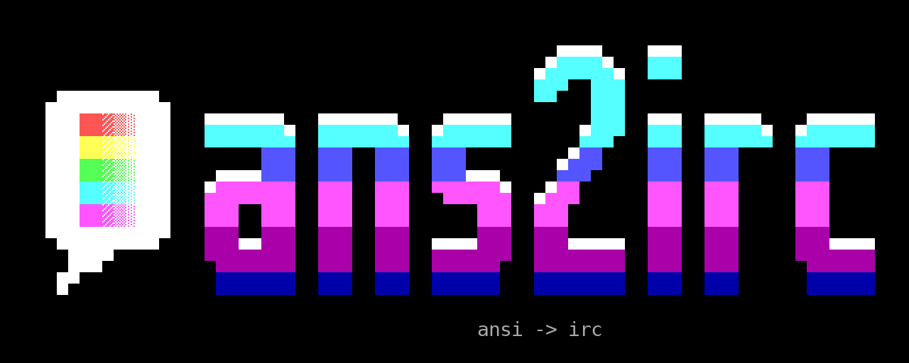

# ans2irc

<p align="center"></p>

Convert ANSI art to mIRC-coloured text for IRC, one message per line, in as
few bytes as the picture allows.

IRC caps a message at 512 bytes, and on most networks the sender's
`nick!user@host` and the channel name come out of that, leaving 400 or so for
the art. Block art is expensive: every `█▀▄░▒▓` is three bytes of UTF-8, and
every colour change costs up to six more. An 80-column piece converted naively
often runs past the limit, and the server silently cuts the end off the line.

ans2irc finds the shortest encoding of each line, and when a budget is given
and even that is too long, merges colours until the line fits before it ever
cuts one.

```sh
ans2irc art.ans                       # convert, lossless
ans2irc -m 400 art.ans                # every line in 400 bytes
ans2irc -f 'nick!user@host' '#chan' art.ans   # the exact budget for that sender and channel
```

## Install

**Arch Linux** (AUR), from source or as a static binary:

```sh
yay -S ans2irc        # or: paru -S ans2irc
yay -S ans2irc-bin
```

**macOS** (Homebrew):

```sh
brew install mmoyles87/tap/ans2irc
```

or a binary for Apple silicon (`aarch64-apple-darwin`) or Intel
(`x86_64-apple-darwin`) from the
[releases page](https://github.com/mmoyles87/ans2irc/releases).

**Ubuntu** 22.04, 24.04, 26.04 and 26.10 ([PPA](https://launchpad.net/~mattmoyles/+archive/ubuntu/ans2irc)):

```sh
sudo add-apt-repository ppa:mattmoyles/ans2irc
sudo apt install ans2irc
```

**Debian and other Debian-based distributions:**

```sh
curl -LO https://github.com/mmoyles87/ans2irc/releases/download/v0.1.0/ans2irc_0.1.0-1_amd64.deb
sudo apt install ./ans2irc_0.1.0-1_amd64.deb
```

**Fedora, RHEL 9 and 10, Alma, Rocky** ([COPR](https://copr.fedorainfracloud.org/coprs/mmoyles87/ans2irc/)):

```sh
sudo dnf copr enable mmoyles87/ans2irc
sudo dnf install ans2irc
```

or any rpm-based distribution, openSUSE included, from the release:

```sh
sudo dnf install https://github.com/mmoyles87/ans2irc/releases/download/v0.1.0/ans2irc-0.1.0-1.x86_64.rpm
```

**Any Linux,** as a static binary:

```sh
curl -L https://github.com/mmoyles87/ans2irc/releases/download/v0.1.0/ans2irc-0.1.0-x86_64-unknown-linux-musl.tar.gz | tar xz
sudo install ans2irc-0.1.0-x86_64-unknown-linux-musl/ans2irc /usr/local/bin/
```

ARM64 builds (`arm64.deb`, `aarch64.rpm`, `aarch64-unknown-linux-musl`) are on
the [releases page](https://github.com/mmoyles87/ans2irc/releases) too.

**From source,** with Rust 1.70 or later:

```sh
cargo install --git https://github.com/mmoyles87/ans2irc
```

No dependencies beyond the standard library.

To try it, convert the banner above:

```sh
curl -sL https://raw.githubusercontent.com/mmoyles87/ans2irc/main/assets/banner.ans | ans2irc -v
```

## Usage

```
ans2irc [options] [file]

  -w, --width N           columns (default: the SAUCE width, else 80)
  -l, --crop-left N       drop N columns from the left
  -r, --crop-right N      drop N columns from the right
  -t, --tab-size N        tab stops every N columns (default: 8)
  -m, --max-bytes N       fit every line in N bytes
  -f, --for MASK TARGET   fit every line for messages from MASK (nick!user@host)
                          to TARGET (#channel or nick)
      --ice, --no-ice     blink is a bright background, or blink
                          (default: the SAUCE flag, else --ice)
  -s, --swap-shades       let the encoder swap ░ for ▓ with the colours reversed
  -n, --no-colour         plain text
  -v, --verbose           report line sizes on standard error
```

It reads a file, or standard input without one, and writes UTF-8 lines to
standard output. Lines it had to recolour or cut are counted on standard error.

## How it saves bytes

Most cells can be drawn more than one way, and which way is cheapest depends
on the colours around them:

- A space shows only its background, so it looks exactly like a full block in
  that colour. A space is one byte and a block is three, but a block might
  avoid a background change. A space's foreground and a block's background
  are left as they are.
- `▀` on one pair of colours is `▄` on the same pair reversed, and `▌` is `▐`
  reversed.
- Any glyph whose foreground and background match is a solid cell.
- With `-s`, `░` is `▓` with the colours reversed, and `▒` either way round.
  The dither patterns differ slightly, so this one is opt-in.

For each line, ans2irc searches every combination of these for the fewest
bytes, along with how to write each colour code:

- Colour numbers take one digit (`\x034`, not `\x0304`) unless the next
  character is a digit.
- A background is written only when it changes. When a background changes and
  the glyph doesn't care about the foreground, the cheapest foreground number
  is chosen.
- A comma right after a colour code would be read as the start of a
  background, so it gets the cheapest of the possible guards.
- A line ending in a coloured space gets a reset after it, so clients that
  strip trailing whitespace don't lose its background. Trailing black space is
  dropped.

On a library of 136 pieces, a2m's output came to 2,027,427 bytes and
ans2irc's to 1,550,992, 23% smaller. No line of ans2irc's was over 390
bytes.

## Fitting a budget

With `-m` or `-f`, a line still over budget after the search is recoloured a
run at a time: the run of cells whose change to a neighbour's colours (or to
just its foreground or background) alters the picture least for each byte it
saves goes first, and so on until the line fits. Only when no merge is left
are cells cut from the right, which only happens when the glyphs alone don't
fit, as with 120-column pieces under a 360-byte budget.

## ANSI support

CP437 text, with the control range drawn as DOS drew it; SGR colours,
including bright (`90–97`, `100–107`), xterm 256-colour and 24-bit colour
(mapped to the nearest of mIRC's 99), and PabloDraw's 24-bit `t` sequences;
cursor movement, save and restore, erase in line and clear screen; tabs; SAUCE
width and iCE colour; and line wrap at the canvas width.

## License

GPL-3.0-or-later; see `LICENSE`.
